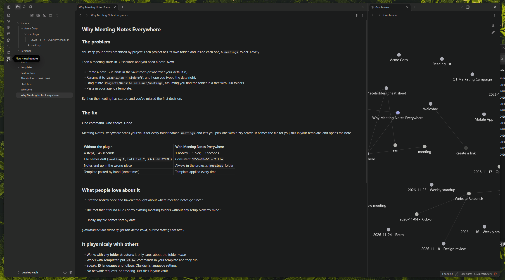

# Meeting Notes Everywhere

Create a meeting note and pick which of your meeting folders it goes into.



If you keep a `meetings` folder in every project (the same way you might keep an attachments folder next to your notes), this plugin finds all of them for you. Run one command, choose the folder from a list, type a title, done.

## Features

- **Finds every meeting folder in your vault.** Any folder named `meetings` (configurable, case-insensitive) is offered in a fuzzy-search list.
- **Shows where each folder lives.** All meeting folders have the same name, so the list shows the folder that contains each one, e.g. `Projects/Website relaunch`.
- **Recently used folders come first.**
- **Create a meeting folder on the fly.** Pick "+ Create new meeting folder …" and choose where it should go.
- **Configurable file name** with placeholders. The default is `{{date:YYYY-MM-DD}} - {{title}}`, which gives `2026-11-25 - Kick-off.md`.
- **Optional template.** The same placeholders work inside it. If [Templater](https://github.com/SilentVoid13/Templater) is installed, `<% %>` commands are run too.
- **Right-click a folder** → "New meeting note here".
- **Available in 15 languages.** The plugin follows Obsidian's language setting.

## Usage

1. Run **New meeting note** from the command palette, or click the calendar icon in the ribbon.
2. Pick a meeting folder.
3. Type a title. This is optional, and a preview shows the resulting file name. Press <kbd>Enter</kbd>.

To make this faster, assign a hotkey in *Settings → Hotkeys*.

## Settings

| Setting | Default | Description |
| --- | --- | --- |
| Meeting folder name | `meetings` | Every folder with this name is suggested. To match several names, separate them with commas, e.g. `meetings, Besprechungen`. New folders use the first name. |
| File name | `{{date:YYYY-MM-DD}} - {{title}}` | Pattern for new notes (see placeholders). |
| Template | *(empty)* | Path to a note whose content is copied into each new meeting note, e.g. `templates/meeting.md`. |
| Open in new tab | off | Open the created note in a new tab. |

### Placeholders

| Placeholder | Result |
| --- | --- |
| `{{title}}` | The title you typed. |
| `{{date}}` | Today's date as `YYYY-MM-DD`. |
| `{{date:FORMAT}}` | Today's date in any [moment.js format](https://momentjs.com/docs/#/displaying/format/), e.g. `{{date:DD.MM.YYYY}}`. |
| `{{time}}` / `{{time:FORMAT}}` | Current time, `HH:mm` by default. |
| `{{parent}}` | Name of the folder that contains the meeting folder, usually the project. |
| `{{folder}}` | Full path of the meeting folder. |

Placeholders the plugin doesn't recognise are left unchanged. Characters that aren't allowed in file names are removed. If a file with the same name already exists, ` (2)`, ` (3)`, … is appended.

## Languages

English, Deutsch, Français, Español, Italiano, Português, Nederlands, Polski, Русский, Українська, Türkçe, 日本語, 한국어, 简体中文, 繁體中文.

Translations live in [`src/i18n.ts`](src/i18n.ts). Corrections and new languages are welcome as pull requests.

## Installation

**From Obsidian (once the plugin is listed):** *Settings → Community plugins → Browse*, search for "Meeting Notes Everywhere".

**Manually:** Download `main.js`, `manifest.json` and `styles.css` from the [latest release](../../releases/latest). Put them in `<vault>/.obsidian/plugins/meeting-notes-everywhere/`, then enable the plugin.

## Development

```bash
npm install
npm run dev      # watch build
npm run build    # type-check + production build
npm run deploy   # build and copy into a vault (set OBSIDIAN_VAULT or put the path in a .vault file)
```

To publish a release, set the new version in `manifest.json` and `versions.json`, commit, then push a tag with exactly that version (e.g. `git tag 0.1.1 && git push --tags`). The GitHub Action builds the plugin and creates the release.

## License

[MIT](LICENSE)
